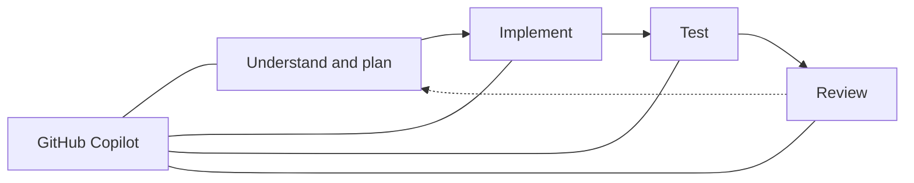

# Agentic SDLC with GitHub Copilot

This standalone, four-challenge workshop is adapted from the Microsoft [MicroHack Agentic SDLC workshop](https://github.com/microsoft/MicroHack/tree/main/03-Azure/01-04-AI/01_Agentic_SDLC).

## Introduction

Build with **Octocat Supply**, a full-stack supply-chain application, while practising an agentic software development loop: understand a repository, implement features, refine requirements, test, and review with GitHub Copilot.

The application includes a **React + Vite + Tailwind** frontend, four interchangeable REST APIs (TypeScript, C#, Python, and Java), and a shared **SQLite** schema. Choose one API variant; the workshop concepts are language-agnostic.

This shortened workshop focuses on local development and the core plan → implement → test → review loop. Azure deployment, production operations, and later challenges are intentionally not included.

## Repository contents

- [`src/`](src/README.md): the Octocat Supply frontend, all four API variants, shared database, tests, and build commands.
- [`.devcontainer/`](.devcontainer/): a Codespaces/dev-container environment with the required application runtimes.
- [`.vscode/`](.vscode/): editor tasks, launch configurations, and MCP configuration for the retained exercises.
- [`.github/`](.github/): repository Copilot instructions, path-specific guidance, a design skill, and the Challenge 3 requirement-refinement agent.
- [`assets/`](assets/): the Challenge 3 backlog and mock WorkIQ organizational inputs.
- [`scripts/`](scripts/README.md): optional Bash and PowerShell helpers for seeding the backlog into GitHub Issues.

## Prerequisites

- A GitHub account with access to this repository and an active GitHub Copilot entitlement.
- VS Code with the GitHub Copilot extensions, either in GitHub Codespaces, the included Dev Container, or a local environment.
- Node.js for the frontend plus the runtime for your chosen API track. The Dev Container includes Node.js, Python, .NET, and Java.
- GitHub CLI is optional; it is needed only for the backlog-seeding helper and GitHub MCP workflows.

## Challenges

1. [Dev environment, Copilot access & repository overview](challenges/challenge-01.md) **← Start here**
2. [Deliver a new feature (the cart)](challenges/challenge-02.md)
3. [Add another feature from the backlog (agentic loop)](challenges/challenge-03.md)
4. [Run and extend test coverage, and review code](challenges/challenge-04.md)

## Worked approaches

These are spoilers; attempt each challenge first.

1. [Challenge 1 walkthrough](walkthrough/challenge-01/solution-01.md)
2. [Challenge 2 walkthrough](walkthrough/challenge-02/solution-02.md)
3. [Challenge 3 walkthrough](walkthrough/challenge-03/solution-03.md)
4. [Challenge 4 walkthrough](walkthrough/challenge-04/solution-04.md)

## Learning outcomes

After the four challenges, you can:

- use Copilot to understand and plan changes in a multi-component application;
- implement a scoped full-stack feature while preserving existing patterns;
- refine a backlog requirement from repository and organizational context;
- run and extend existing tests with meaningful edge-case coverage; and
- perform and act on an agent-assisted code review.

## Suggested timebox

| Time | Activity |
| --- | --- |
| 0:00–0:30 | Challenge 1 |
| 0:30–1:15 | Challenge 2 |
| 1:15–2:15 | Challenge 3 |
| 2:15–3:00 | Challenge 4 |

## Attribution and license

This repository preserves material from [`microsoft/MicroHack`](https://github.com/microsoft/MicroHack), specifically the Agentic SDLC workshop on the `main` branch. The original workshop contributor is **Francesco Lana** ([GitHub](https://github.com/Frank802), [LinkedIn](https://www.linkedin.com/in/franklana)).

Original content is copyright Microsoft Corporation and distributed under the [MIT License](LICENSE). Adaptations in this repository retain that license and attribution.
